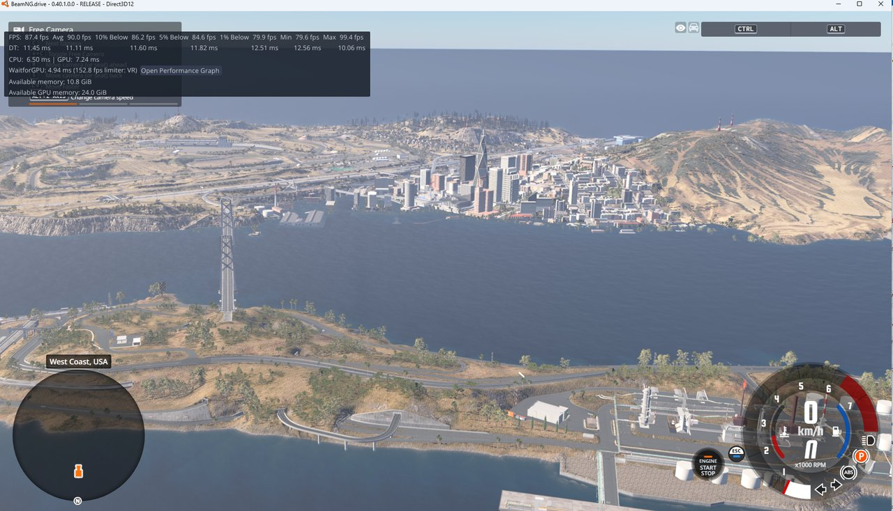
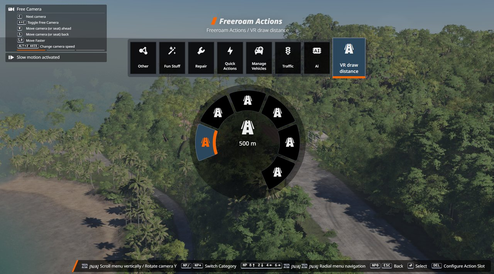
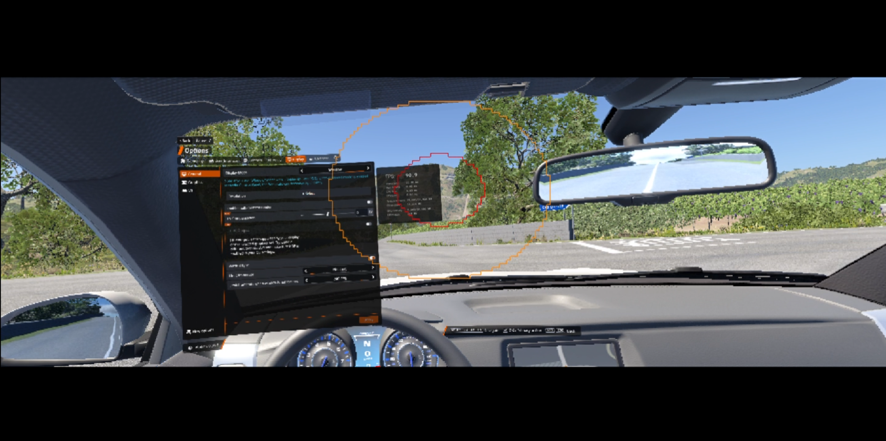

# BeamNG-VRS

Foveated rendering for **BeamNG.drive VR** (Direct3D 12 or Vulkan), plus edge cropping and a lens-corner mask.
Keep more detail where you look and reduce rendering work around the edges.
Works with a fixed center or supported eye tracking.

**Windows x64 · Release 0.4.1 · built for BeamNG.drive 0.40.** Performance varies by headset, GPU and scene.

## What's new in 0.4.1

- **Right-eye ghosting fix.** BeamNG 0.40 builds local exposure and bloom from one eye
  and reuses them for the other, leaving "ghost" shapes in the right eye. BeamNG-VRS
  patches the game's combine shader so each eye reads them at its own position. On by
  default (`[Renderer] GhostingFix=true`); the first start after installing is slower
  while BeamNG rebuilds its shader cache.
- **The log says what limits your frame rate:** the `M8.47` line now ends with
  on target, GPU-bound, CPU-bound or runtime-bound.

## In 0.4.0

- **VR draw distance.** BeamNG 0.40 draws VR out to 10000 m, further than the
  desktop's 8000 m, and no game setting changes it. BeamNG-VRS now sets it to
  **4000 m by default**, which looks almost the same and saves GPU and CPU time.
  Change it with `[Renderer] VRDrawDistance` (100 to 10000, or `off`) in the INI,
  or live in game from the radial menu: **Freeroam Actions > VR draw distance**
  (500 / 1000 / 2000 / 4000 / 6000 / Full). A "VR draw distance" UI app with a
  slider is also available. Your in-game pick is kept for the next launch.

- **Sharper picture, your choice.** BeamNG 0.40 renders VR at 50% and upscales it,
  which looks soft. Uncomment `RenderScale=1.0` under `[Renderer]` in the INI for
  full resolution (it costs more GPU; 0.67 to 0.8 is a middle ground). With the
  4000 m draw distance, 1.0 stayed within the 90 Hz budget on an RTX 5090.

*West Coast, USA at the 4000 m default with render scale 1.0 (RTX 5090): the whole city and bay still in view, GPU 7.2 ms.*

## What's new since 0.2

- **Moved to Direct3D 12 VR.** BeamNG 0.40 renders VR with Direct3D 12, and the launcher now
  starts it that way. Foveation (fixed or eye-tracked) needs a GPU with D3D12 VRS Tier 2.
  Vulkan still works with `[Renderer] API=vulkan`.
- **New option to force the VR render scale.** BeamNG 0.40 renders VR at 50%;
  `[Renderer] RenderScale` (0.25 to 1.0) sets your own. 1.0 is much sharper but costs more GPU.

## Install

1. [Download the Windows ZIP](https://github.com/Letrange-g/BeamNG-VRS/releases/download/v0.4.1/BeamNG-VRS-0.4.1-windows-x64.zip) (not the source-code ZIP).
2. Close BeamNG and extract the whole ZIP into the game folder, beside `Bin64`.
3. Double-click `Launch-BeamNG-VRS.cmd`, then enable VR in the game.

Edit **`BeamNG-VRS.ini` beside the launch CMD** in Notepad to change settings.
Restart the game after every change. Extraction inside `Bin64` also works.
Windows PowerShell is included in Windows 10/11; the package adds no EXE.

## Settings

- **Foveation Enabled:** set `false` to use scissor or turbo without VRS. Default `true`.
- **Size1x1:** size of the sharp, full-quality center. Default `0.25`.
- **Size2x2:** size of the medium-quality region around it. Default `0.55`.
- **Shape:** `circle` (default), `ellipse`, or `square`.
- **DrawOutline:** shows the quality-region borders for checking settings. Leave `false` for gameplay.
- **Scissor:** crops image edges to save rendering work. Enabled by default; check the edges in your headset.
- **RenderScale:** Direct3D 12 VR render scale, `0.25` to `1.0`. Not set by default (game uses `0.5`); set `1.0` for the sharpest picture.
- **VRDrawDistance:** VR draw distance in metres, `100` to `10000`. Default `4000`; `off` keeps the game's 10000 m. Also changeable in game from the radial menu.
- **LensMask:** skips the image corners hidden by the lenses. Enabled by default (`Size=1.15`); increase `Size` if you see black corners.

If fine detail shimmers with VRS, try BeamNG's MSAA setting, or disable foveation
and use scissor alone. MSAA's performance cost varies by setup.

Scissor top/bottom apply to both eyes. Horizontal edges are independent:

| INI setting | Edge | Default |
| --- | --- | --- |
| `Top` / `Bottom` | Top / bottom of both eyes | `0.30` each |
| `LeftEyeLeft` | Left eye, outside | `0.10` |
| `LeftEyeRight` | Left eye, near the nose | `0` |
| `RightEyeLeft` | Right eye, near the nose | `0` |
| `RightEyeRight` | Right eye, outside | `0.10` |

`0.05` crops 5% from that edge. Start small; keep the nose-side values at `0`
if you can see those borders. Scissor is **enabled by default**; set `Enabled=false` to turn it off.
[All settings and examples →](docs/CONFIGURATION.md)

**Turbo:** off by default. `[Performance] TurboMode=true` overlaps CPU work with the headset runtime wait;
it only helps when the CPU is the limit. Check smoothness as well as FPS.
It may interfere with motion reprojection. `[Logging] Level=off` disables layer
logs; other choices are `errors`, `info` (default), and `debug`.

## See it in action

**VRS + scissor in game:** red outlines the full-quality region; orange marks
the outer 2x2 boundary. Black borders show the scissor crop. Turn debug outlines
off for gameplay.

[VRS off](https://youtu.be/dfVtQ83cNbM) ·
[VRS on](https://youtu.be/psoPj8rjUV8) ·
[VRS + scissor](https://youtu.be/jXkz3hwZiLg)

The comparison videos have debug outlines enabled. Turn them off when comparing performance.

## Update or remove

Back up your INI, extract the new ZIP, then restore your settings in the INI beside
the launch CMD, so you get the new `[OpenXR]` and `[Renderer]` sections. Update the launcher and both DLLs together. Older `Left`/`Right`
settings still work; the four new controls let you adjust each eye separately.

Launch BeamNG normally to stop using VRS. To uninstall, remove the `BeamNG-VRS`
folder, `BeamNG-VRS.ini`, both CMD files and `READ-ME-FIRST.txt`. Also delete
`mods\unpacked\beamng_vrs` and `settings\beamng_vrs_vr_draw_distance.txt` in your BeamNG user folder.

[Help and requirements](docs/TECHNICAL.md) · [Performance notes](docs/PERFORMANCE.md) ·
[Source guide](docs/SOURCE-GUIDE.md) · [Build from source](docs/BUILDING.md) · [Report an issue safely](docs/SECURITY.md)

Unofficial project. [MIT license](LICENSE).
