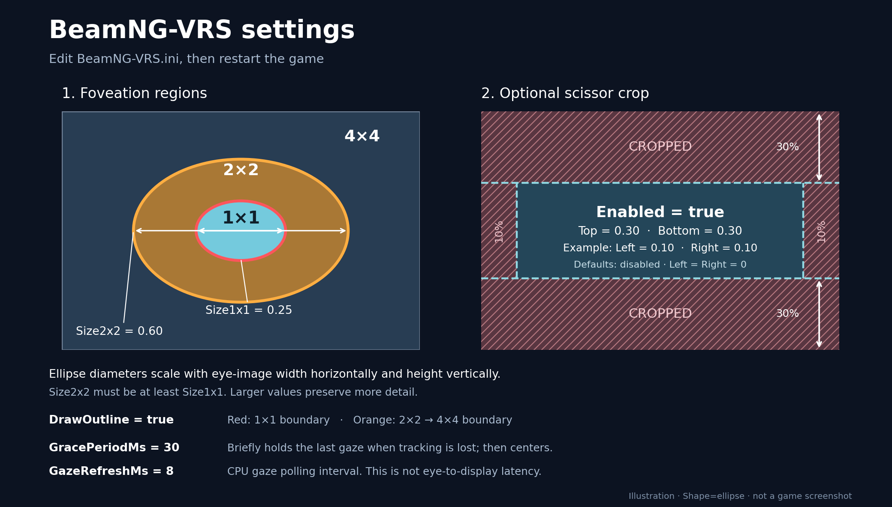

# BeamNG-VRS (experimental source)

An **unofficial, experimental** pair of Windows API layers for **BeamNG.drive** Vulkan VR rendering:

- **`BeamNG_VRS.dll`** – Vulkan layer applying per-eye fragment shading-rate patterns.
- **`BeamNG_EyeProbe.dll`** – OpenXR API layer collecting gaze/eye-swapchain information when supported.

The project supports fixed center foveation without eye tracking, and eye-following foveation when an OpenXR eye-tracking source is available. Center and middle regions can be **circle**, **square**, or **ellipse** (the default). Ellipse uses width/height-relative diameters; circle uses height-relative diameter and square uses height-relative side length. The debug view can show a red 1×1 boundary and an orange 2×2-to-4×4 boundary.

[Watch the user's foveated VRS demonstration](https://gofile.io/d/0497e367-c9e8-4831-8618-0a52bc37e277) (video hosted on GoFile).

Recorded Italy-map comparisons supplied by the user:

- [VRS off](https://youtu.be/dfVtQ83cNbM)
- [VRS on](https://youtu.be/psoPj8rjUV8)
- [VRS on with scissor](https://youtu.be/jXkz3hwZiLg)

The VRS recordings include debug outlines. For performance comparisons, repeat
with `DrawOutline=false`, the same stationary camera and identical graphics,
resolution and headset settings; see the [comparison procedure](docs/PERFORMANCE.md#compare-in-beamng).

## Status

**Experimental beta.** M8.28 reuses completed transfer command recordings on top of M8.27's faster CPU patterns, allocation-free dispatch, identical-upload skipping, completed-resource reuse and independent gaze projection freshness. It retains the earlier dual outlines, gaze grace, region shapes and lazy framebuffers. Earlier rendering tests primarily covered a Pimax Dream Air and NVIDIA RTX 5090. Automated checks cover configuration, DLL loading, launcher behavior and mock rendering lifetimes. These changes still need testing in BeamNG with the target GPU/headset; see [performance findings and the comparison procedure](docs/PERFORMANCE.md).

The layers read **`BeamNG-VRS.ini`** beside the DLLs. A portable ZIP launcher and a Windows build/package workflow are included. **No compiled DLLs are committed** in this repository; binary beta packages are distributed through GitHub Releases.

## Portable installation

1. Download the Windows x64 ZIP from [Releases](https://github.com/Letrange-g/BeamNG-VRS/releases) when a beta is available. Use the binary ZIP, not GitHub's source-code ZIP.
2. Close BeamNG and extract the entire ZIP into its installation root, beside `Bin64`. Extraction directly inside `Bin64` also works; keep `Launch-BeamNG-VRS.cmd` and the `BeamNG-VRS` folder together.
3. Edit `BeamNG-VRS/BeamNG-VRS.ini` in Notepad if desired.
4. Start Steam if your installation requires it, then double-click `Launch-BeamNG-VRS.cmd`.
5. Enable VR in the game as usual. Restart after changing settings.

The launcher validates settings, starts the game in Vulkan mode, and activates both layers for that process. The ZIP is for Windows x64 and remains an experimental beta; see the requirements below before using it.

The launcher uses Windows PowerShell 5.1, included by default in Windows 10 and 11. PowerShell 7 is not required. The PowerShell launcher validates your INI automatically before launch. The package contains no EXE files.

If normal Vulkan works but this launcher reports no rendering device, run `Diagnose-BeamNG-VRS.cmd`. Close the game and any error dialog, then inspect the Vulkan loader log at the path printed in the window. The launcher adds its Vulkan layer folder while preserving normal layer discovery. Run it with your normal user account; elevated applications ignore Vulkan layer search paths.

If a previous beta logs `Failed to open dynamic library "./BeamNG_VRS.dll" with error 87`, update to beta.4 or newer. It corrects the Windows relative paths in both loader manifests.

The ZIP keeps its DLLs and settings inside `BeamNG-VRS/`; it does not replace original game files or register layers globally. Launch BeamNG normally to stop using the layers. To uninstall, close the game and remove that folder and both launch shortcuts. Back up the INI before extracting an update.

When updating from beta.4 or earlier, delete the old `BeamNG-VRS/BeamNG-VRS-Check.exe`; the launcher no longer uses it. Restoring an old INI preserves its settings. To use the new defaults, set `Shape=ellipse`, `Top=0.30`, and `Bottom=0.30` or use the new INI.

## Build

See [docs/BUILDING.md](docs/BUILDING.md) for required SDKs, CMake configuration and loader manifests. There is no globally installed layer and no game-file patching needed for the source workflow.

## Configuration

See [docs/CONFIGURATION.md](docs/CONFIGURATION.md). The user-facing controls are:



```ini
[Foveation]
Size1x1=0.25
Size2x2=0.60
Shape=ellipse

[Debug]
DrawOutline=false

[Scissor]
Enabled=false
Top=0.30
Bottom=0.30

[Tracking]
GracePeriodMs=30
GazeRefreshMs=8
```

Restart BeamNG after editing. For ellipse, sizes are diameters relative to eye-image width horizontally and height vertically. Circle uses height for its diameter; square uses height for its side length. The public launcher uses the INI settings; existing environment overrides remain supported when loading the layers through developer scripts.

## Notes and limitations

- Both layers are experimental and can cause application or headset-runtime instability.
- A Vulkan driver must support the required attachment shading-rate features. Unsupported configurations need testing and should fail safely.
- OpenXR visibility masks were unavailable in tested sessions; the experimental stencil implementation is **disabled** in the recommended configuration. Scissor crop is also experimental.
- Faster gaze polling and CPU source-to-upload measurements do **not** measure eye-to-display latency.
- The debug outline is injected into game rendering, and may appear in temporal history; disable it for normal gameplay.
- Do not distribute log files, dumps, private headset identifiers, or graphics captures without reviewing them.
- The code is not an official BeamNG or headset-vendor project. No affiliation or endorsement is implied.

## Privacy and contributions

Only curated source, manifests, and portable tests are included. No user logs, executables, graphics captures, API keys or personal settings are committed. See [docs/SECURITY.md](docs/SECURITY.md) before reporting an issue.

**License:** [MIT](LICENSE).
