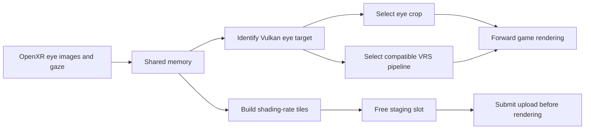

# Reading the source

BeamNG-VRS has two DLLs. The Vulkan DLL changes eligible rendering commands;
the OpenXR DLL identifies the headset's eye images, supplies gaze information,
and optionally changes when the game waits for its next VR frame.

Start with the small configuration and geometry helpers, then follow an API
callback into the larger layer files. You do not need to read `layer.cpp` from
top to bottom.

## Where to look

| File | Responsibility | Useful starting point |
| --- | --- | --- |
| `packaging/BeamNG-VRS.ini` | Public controls and defaults | Sections and their comments |
| `src/ini_config.hpp` | Portable INI parsing, validation and internal feature gates | `defaults`, `setting`, `parse`, `activation` |
| `src/windows_config.hpp` | Locate/cache the INI; support developer environment overrides | `configPath`, `fileValues`, `read` |
| `src/ffr_pattern.hpp` | Build the per-eye shading-rate tile image | `make`, `makeGaze`, region geometry and row spans |
| `src/scissor_crop.hpp` | Calculate retained pixels and four non-overlapping border rectangles | `make` |
| `src/layer.cpp` | Intercept Vulkan calls; manage pipelines, crop state and GPU uploads | Functions listed below |
| `src/openxr_probe.cpp` | Intercept OpenXR calls; identify eyes, publish gaze and route turbo | `probeCreateSession`, `probeEndFrame`, `probeWaitFrame` |
| `src/openxr_turbo.hpp` | One-frame async wait scheduler | `Scheduler::wait`, `begin`, `end`, `drain`, `stop` |
| `src/d3d12_probe.cpp` | D3D12 side (BeamNG 0.40 DX12 VR), driven from the OpenXR layer: VRS Tier 2 foveation on eye-shaped render targets (M8.42), scissor clipping, lens-corner rates and final-image black edges/outline (M8.43), and the diagnostics render-target report (M8.41), via vtable hooks | `attach`, `bind`, `updateFoveation`, `hookRSSetScissorRects`, `finishEyeImage` |
| `src/vr_far_scan.hpp` | VR draw distance (M8.50): portable search of the game executable for the 10000 m VR far value, starting from the OpenXR view strings | `scan`, `anchorStrings`, `ripRefs`, `callees` |
| `src/vr_far_patch.cpp` | Applies the scan to the running game, redirects each site to our own value, and changes it live (M8.51) | `patchRunningGame`, `setDistance`, `allocateNear` |
| `packaging/Launch-BeamNG-VRS.ps1` (Lua mod) | Writes the `beamng_vrs` mod: render scale, and the VR draw distance radial menu entry and UI app, which save the pick to a file the OpenXR layer polls | `Update-VRMod`, `Get-VRDrawDistanceStart` |
| `src/ffr_upload_commands.hpp` | Reuse completed upload recordings/resources | Cache and ownership helpers |
| `src/beamng_gaze_shared.hpp` | Shared-memory structures used between the DLLs | Mapping names and data structures |
| `tests/` | Executable examples of configuration and lifetime rules | Parser, crop, hook and turbo tests |

The `M8.xx` prefixes mostly identify the experiment which introduced a function.
They are not different public modes that users must configure. For example,
`m89Variants` holds our compatible VRS pipelines; `m830CropVariants` holds the
additional per-eye static crop pipelines.

## Following a frame

The two DLLs run in the game process but have separate globals. They exchange
small shared-memory records. Sequence counters mark a writer in progress;
a reader accepts a record only when the sequence is unchanged and even.
Check the process ID as well: a mapping name alone does not establish ownership.

### Vulkan entrypoints

1. **Device creation:** resolve downstream driver functions and detect required
   VRS support. `DeviceDispatch` is deliberately small and trivially copyable:
   command hooks copy it frequently, so it must not contain owning vectors/maps.
2. **Pipeline creation:** retain the game's handles and create compatible copies
   where needed. Here, “shadow” means our VRS copy of a render pass/framebuffer,
   rather than a lighting shadow map. Static crop copies are created here,
   rather than compiling pipelines during a draw.
3. **Render-pass begin:** `m57SelectShadow` redirects only a classified eye to a
   compatible VRS target. `m830StartCrop` records the crop context for that
   command buffer. Eye 0 is left; eye 1 is right. Eye identity comes from image
   transfers to OpenXR images, not the order of render passes.
4. **Draw setup:** `vkCmdBindPipeline` chooses a compatible VRS/static-crop copy;
   `vkCmdSetScissor` intersects dynamic rectangles with the crop and render area.
   `cropBlackBars` clears excluded borders at the end of a qualifying pass.
5. **Uploads:** `m84PrepareEyePatterns` writes only free CPU staging slots.
   Queue-submit hooks consume and pin those slots. A slot becomes reusable only
   after the corresponding fence signals. Identical tile data needs no new upload.

Unknown or mixed-eye targets use the common horizontal crop, retaining pixels
either eye needs. Crop operates on matching legacy, single-layer, inline passes;
it does not remove scene objects or change the VR projection. See
[TECHNICAL.md](TECHNICAL.md) for the scope and known limits.

### OpenXR and turbo

`probeCreateSession` records ownership even with VRS disabled. Scissor still
needs eye-image/resolution information, and turbo does not require eye tracking.
The interceptors copy downstream function pointers under `stateMutex`, release
the lock, then call the runtime. Never hold that global lock across a blocking
wait or while joining the turbo worker.

With turbo off, the runtime receives the game's frame calls directly.
With turbo on:

1. The first wait/begin/end is normal.
2. After a successful end, one persistent worker starts the next runtime wait.
3. The next app wait uses the real state if ready; otherwise it can return a
   short extrapolation, allowing CPU/render work to begin while the runtime waits.
4. Before submission, the scheduler finishes that real wait and calls the real
   begin, then forwards the game's end. It can now prefetch one more frame.

`Phase` documents whether a frame belongs to the app or has only been prefetched.
There is never a second prefetched wait before consuming the first. Runtime
errors reach the app and disable further prefetching. Extension chains are
forwarded synchronously rather than retaining caller-owned pointers. An app
already pipelining frames falls back to its normal frame scheduling.

`drain` waits before swapchain destruction. `stop` balances an unused prefetch
with an empty frame and joins the worker before session/instance destruction.
OpenXR offers no cancellation for `xrWaitFrame`: a broken runtime can still
stall while draining; detaching a thread would risk calling a destroyed session.
Turbo can interfere with motion reprojection and needs headset testing.

## Making a small change

For a **new INI control**, update the C++ parser, PowerShell validator, packaged
INI, configuration guide and parser-agreement tests together. Identical keys in
different sections are independent; duplicate keys within a section are rejected.
Internal environment overrides remain for developer scripts; the public launcher
clears them in its child process and explicitly selects the root INI.

For **geometry changes**, use the portable crop/pattern tests first. Pattern
changes must match the byte-level reference unless a deliberate visual change is
intended. Geometry tests check pixel coverage, including corners and tiny images.

For **frame/upload changes**, test call order and ownership, not just counters.
The turbo fixture blocks a real callback to prove the app can proceed while
submission/teardown still waits. Upload tests check that in-flight memory is not
reused. Mock callbacks do not establish GPU correctness or headset appearance.

## Building and checking

Run `bash scripts/run-portable-tests.sh` for the SDK-independent helper tests.
The turbo scheduler test additionally needs the pinned OpenXR headers, and the
real interceptor tests require Windows. [BUILDING.md](BUILDING.md) gives the full
Windows build/test command; the release workflow runs all required checks before
packaging. Test EXEs are never included in the portable user ZIP.

Use `Logging Level=debug` only for diagnosis. The two DLL log files normally live
in `%TEMP%`; `Level=off` skips their logger before message classification and file
access. `Diagnose-BeamNG-VRS.cmd` deliberately overrides this with detailed logs.
